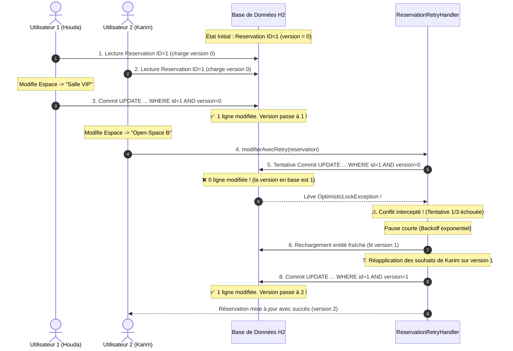

# TP JPA & Hibernate : Verrouillage Optimiste (@Version) et Concurrence Multi-Thread

> **Application de Gestion des Réservations d'Espaces Coworking**  
> **Auteure :** Houda El Amrani  
> **Technologies :** Java, JPA 2.2, Hibernate 5.6, Base H2 In-Memory, JUnit 4, Maven  

---

## 🎯 Objectifs d'apprentissage

1. **Maîtriser le Verrouillage Optimiste (*Optimistic Locking*)** en JPA et comprendre son fonctionnement interne.
2. **Utiliser l'annotation `@Version`** pour détecter automatiquement les collisions d'écritures concurrentes.
3. **Comprendre le piège des contextes de persistance :** Distinguer la mise à jour par entité détachée (`em.merge()`) du simple rechargement (`em.find()`).
4. **Simuler un conflit d'accès concurrent :**
   - *Scénario 1 :* Architecture Web/API REST avec entités détachées.
   - *Scénario 2 :* Conflit multi-thread réel avec synchronisation `CountDownLatch`.
5. **Gérer l'exception `OptimisticLockException`** et mettre en œuvre le pattern **Retry Automatique** avec backoff exponentiel pour garantir une haute disponibilité sans corruption de données.

---

## 🏛️ Architecture & Modèle Relationnel

### Entité `Reservation` (Espace Coworking)

L'entité représente une réservation d'un espace (Bureau privé, Open-space, Salle de réunion) :

```text
+-------------------------------------------------------------+
|                         Reservation                         |
+-------------------------------------------------------------+
| - id : Long [PK, Auto-incrémenté]                           |
| - espace : String [Ex: "Salle Turing VIP", "Box Créatif"]   |
| - reservePar : String [Ex: "Houda El Amrani"]              |
| - dateDebut : LocalDateTime                                 |
| - dateFin : LocalDateTime                                   |
| - motif : String                                            |
| - tarifHeure : double                                       |
| - version : int [@Version - Clé du verrouillage optimiste] |
+-------------------------------------------------------------+
```

---

## 🔬 Mécanisme Interne du Verrouillage Optimiste

### 1. Pourquoi le Verrouillage Optimiste ?
Contrairement au **verrouillage pessimiste** (qui pose des verrous SQL `SELECT ... FOR UPDATE` bloquant physiquement les autres utilisateurs), le **verrouillage optimiste** fait le postulat que les collisions sont rares :
- **Aucun blocage** en lecture ou au début de l'écriture.
- **Scalabilité maximale** pour les applications Web / Cloud.
- La détection de conflit intervient **uniquement au moment du commit**.

### 2. La Requête SQL générée par Hibernate
À chaque mise à jour, Hibernate inclut le numéro de version dans la clause `WHERE` et incrémente la version :

```sql
UPDATE reservations 
SET espace_coworking = ?, tarif_heure = ?, version = 1 
WHERE id = ? AND version = 0;
```

- **Si la ligne existe toujours avec `version = 0` :** La requête met à jour 1 ligne. Le commit réussit et la version en base devient `1`.
- **Si une autre transaction a déjà commit entre-temps :** La version en base vaut déjà `1`. La clause `WHERE version = 0` ne correspond à aucune ligne (0 ligne modifiée). Hibernate détecte immédiatement cette anomalie et déclenche une **`javax.persistence.OptimisticLockException`**.

---

## 🔄 Diagramme de Séquence : Conflit & Résolution par Retry



---

## 💡 Point Technique Essentiel : La Correction Apportée au Tutoriel

> [!IMPORTANT]
> Dans le tutoriel initial de base, la méthode `modifierReservation` utilisait :
> ```java
> Reservation managed = em.find(Reservation.class, reservation.getId());
> managed.setSalle(reservation.getSalle());
> ```
> **Pourquoi cela ne provoquait pas l'exception attendue ?**  
> Parce que `em.find()` recharge la version la plus récente depuis la base dans un nouveau contexte !  
> 
> **Solution professionnelle retenue :**  
> L'utilisation de `em.merge(detachedReservation)` :
> ```java
> Reservation managed = em.merge(detachedReservation);
> em.flush();
> ```
> Ainsi, Hibernate vérifie la version transportée par l'objet détaché par rapport à la base de données, reproduisant fidèlement le cas réel d'un formulaire Web soumis par un utilisateur.

---

## 🚀 Guide d'Exécution & Commandes

Le projet est préconfiguré avec `exec-maven-plugin` et des tests unitaires JUnit 4.

### 1. Lancer les Tests Automatisés
```bash
mvn test
```
*Valide les 4 tests : initialisation de la version, incrémentations successives, détection du conflit par exception, succès du retry automatique et synchronisation multi-thread.*

### 2. Lancer la Simulation de Conflits (Scénario Web + Multi-Thread)
```bash
mvn compile exec:java@simulator
```
*Affiche dans la console l'interception propre de `OptimisticLockException` lors d'un conflit entre deux utilisateurs, puis la simulation avec deux threads synchronisés via `CountDownLatch`.*

### 3. Lancer la Résolution Automatique par Retry
```bash
mvn compile exec:java@retry
```
*Démontre comment le `ReservationRetryHandler` récupère automatiquement l'incident, recharge l'état à jour et réapplique les modifications avec succès.*

---

## 📂 Structure du Projet

```text
reservation-locking/
├── pom.xml
├── README.md
└── src/
    ├── main/
    │   ├── java/com/coworking/
    │   │   ├── model/
    │   │   │   └── Reservation.java              # Entité avec @Version
    │   │   ├── service/
    │   │   │   ├── ReservationService.java       # Interface métier
    │   │   │   └── ReservationServiceImpl.java   # Implémentation JPA avec merge()
    │   │   └── concurrency/
    │   │       ├── ReservationRetryHandler.java  # Gestionnaire de Retry avec backoff
    │   │       ├── ConcurrentReservationSimulator.java # Démonstrateur de conflit
    │   │       └── ConcurrentReservationWithRetry.java # Démonstrateur de résolution
    │   └── resources/
    │       ├── simplelogger.properties           # Formatage des logs console
    │       └── META-INF/
    │           └── persistence.xml               # Configuration JPA et H2
    └── test/
        └── java/com/coworking/
            └── OptimisticLockingTest.java        # Suite de tests JUnit 4 complets
```

---

## 🏆 Bonnes Pratiques en Production

1. **Garder les transactions courtes :** Moins une transaction dure longtemps, plus la probabilité de collision diminue.
2. **Backoff aléatoire (Jitter) :** Lors d'un conflit concurrent, ajouter un léger délai aléatoire avant de retenter pour éviter que les deux transactions ne se rentrent à nouveau dedans en boucle.
3. **Informer l'utilisateur si nécessaire :** Si le retry échoue après $N$ tentatives ou si le conflit implique des règles métier incompatibles (ex: la salle a été réservée par quelqu'un d'autre pour la même heure), lever une exception métier claire invitant l'utilisateur à revalider son choix.
